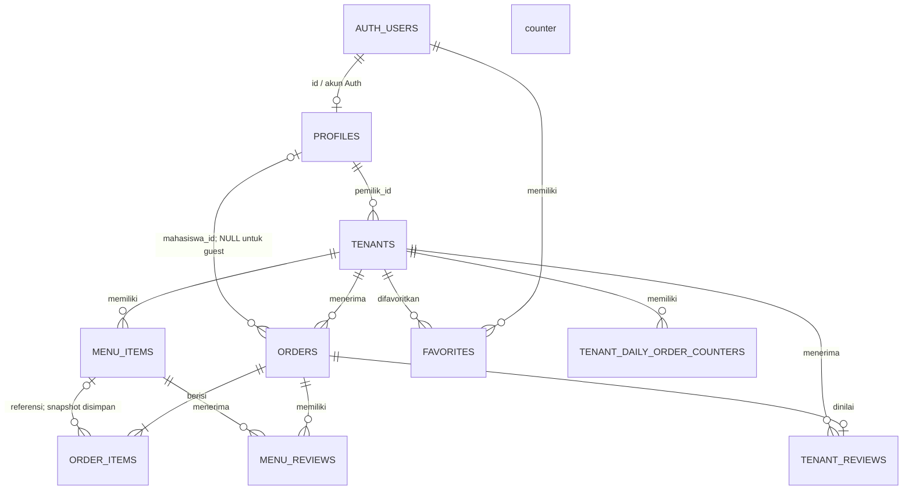

# Database Schema — SiKantin

Dokumen ini merangkum skema yang dapat diverifikasi dari SQL migrations dan query aplikasi dalam repository. Dokumen ini **bukan dump skema live** dan tidak boleh digunakan sebagai DDL pemulihan tanpa membandingkan database Supabase target.

## 1. Catatan Sumber dan Cara Membaca

- Migration aktif ada di [`supabase/migrations/`](./supabase/migrations/).
- Repository tidak menyediakan migration baseline lengkap yang pertama kali membuat `profiles`, `tenants`, `menu_items`, `orders`, dan `order_items`.
- [`sikantin-astro/database/mysql-schema.sql`](./sikantin-astro/database/mysql-schema.sql) adalah skema MySQL lama; bukan sumber tipe/FK PostgreSQL aktif.
- Kolom yang dinyatakan **terverifikasi migration** memiliki tipe/constraint eksplisit pada SQL yang dirujuk.
- Kolom core yang dinyatakan **kontrak aplikasi** dipakai pada query aktif, tetapi tipe/constraint baseline perlu dicocokkan dengan `pg_catalog` atau Supabase Dashboard.
- Tipe core yang ditulis sebagai referensi membantu pembacaan kode, bukan jaminan bahwa seluruh database live identik.

## 2. Tabel Core

### 2.1 `profiles`

Profil aplikasi dipasangkan dengan identitas Supabase Auth. User baru mahasiswa dibuat melalui Edge Function; email Auth memakai pola `[NIM]@uym.ac.id`.

| Kolom | Tipe referensi | Sifat / fungsi |
|---|---|---|
| `id` | `uuid` | ID profil yang sama dengan user Auth; baseline FK tidak disertakan dalam repo. |
| `nama` | `text` | Nama mahasiswa/pemilik yang ditampilkan. |
| `nim` | `text` | NIM mahasiswa; dicari dan divalidasi pada login/checkout. |
| `peran` | `text` | Role aplikasi: `mahasiswa`, `pemilik_tenant`, atau `admin`. Trigger membatasi perubahan role. |
| `no_telepon` | `text` | Nomor kontak/WhatsApp; ditambahkan melalui migration dashboard mahasiswa. |
| `avatar_url` | `text` | URL avatar; ditambahkan melalui migration dashboard mahasiswa. |
| `created_at`, `updated_at` | `timestamptz` | Timestamp bila tersedia pada baseline; definisi aktual perlu diverifikasi. |

### 2.2 `tenants`

| Kolom | Tipe referensi | Sifat / fungsi |
|---|---|---|
| `id` | `uuid` | Primary key baseline. |
| `nama_tenant` | `text` | Nama tenant. Perubahan nama memicu pembaruan slug melalui trigger. |
| `slug` | `text` | URL tenant; trigger menghasilkan slug dan migration guest checkout menambahkan unique index serta `NOT NULL`. |
| `pemilik_id` | `uuid` | ID profil pemilik; dipakai policy pemilik tenant. FK baseline perlu diverifikasi. |
| `lokasi` | `text` | Lokasi yang ditampilkan di katalog. |
| `jam_operasional` | `text` | Teks kompatibilitas/tampilan untuk jam kerja lama. |
| `jam_buka` | `time` | Jadwal otomatis WIB; ditambahkan oleh migration `20261029000007_tenant_operating_hours.sql`. |
| `jam_tutup` | `time` | Jadwal tutup otomatis WIB; ditambahkan bersama `jam_buka`. |
| `override_until` | `timestamptz` | Akhir override manual; scheduler tidak menimpa status sebelum waktu ini. |
| `no_telepon` | `text` | Kontak tenant; ditambahkan pada migration admin CRUD. |
| `qris_image_url` | `text` | URL QRIS tenant; definisi core perlu dicocokkan dengan baseline live. |
| `status_buka` | `boolean` | Status operasional efektif yang dipakai katalog dan validasi checkout. |
| `created_at`, `updated_at` | `timestamptz` | Timestamp baseline bila tersedia; verifikasi pada proyek live. |

Constraint yang dibuat untuk jam operasi:

- `(jam_buka IS NULL) = (jam_tutup IS NULL)` — keduanya harus diisi atau dikosongkan bersama.
- `jam_buka IS NULL OR jam_buka <> jam_tutup` — jam buka dan tutup tidak boleh sama.
- Jam tutup lebih awal daripada jam buka diperbolehkan untuk tenant yang beroperasi melewati tengah malam.

### 2.3 `menu_items`

| Kolom | Tipe referensi | Sifat / fungsi |
|---|---|---|
| `id` | `uuid` | Primary key baseline. |
| `tenant_id` | `uuid` | Tenant pemilik menu; FK baseline perlu diverifikasi. |
| `nama_menu` | `text` | Nama menu dan snapshot pada order item. |
| `harga` | `numeric` | Harga satuan yang dibaca server saat checkout. |
| `kategori` | `text` | Kategori filter menu. |
| `tersedia` | `boolean` | Ketersediaan menu; guest hanya melihat menu tersedia. |
| `foto_url` | `text` | URL foto menu. |
| `waktu_persiapan` | `integer NOT NULL DEFAULT 0` | Ditambahkan oleh migration admin CRUD. |
| `add_ons` | `jsonb NOT NULL DEFAULT '[]'::jsonb` | Array add-on; migration mensyaratkan `jsonb_typeof(add_ons) = 'array'`. |
| `created_at`, `updated_at` | `timestamptz` | Kolom baseline, bila ada; definisi aktual belum disediakan repo. |

Objek add-on pada JSON array memiliki `id`, `name`, dan `price`. Edge Function memvalidasi struktur, harga, duplikasi ID, dan memastikan add-on pilihan masih terkonfigurasi pada item.

### 2.4 `orders`

| Kolom | Tipe referensi | Sifat / fungsi |
|---|---|---|
| `id` | `uuid` | Primary key baseline. |
| `tenant_id` | `uuid` | Tenant penerima order. |
| `mahasiswa_id` | `uuid NULL` | User Auth mahasiswa login; NULL untuk guest. Migration guest secara eksplisit menghapus `NOT NULL`. |
| `nim_guest` | `text NULL` | NIM guest; ditambahkan pada migration guest checkout. |
| `nama_mahasiswa` | `text` | Snapshot nama pembeli saat transaksi. |
| `phone` | `text` | Snapshot nomor WhatsApp pembeli. |
| `nomor_pesanan` | `text` | Nomor order yang dapat ditampilkan. |
| `token_pesanan` | `text` | Token pelacakan; migration membuat unique index. Perlakukan sebagai rahasia. |
| `nomor_antrean` | `text NULL` | Nomor antrean harian, misalnya `A-01`. |
| `tanggal_antrean` | `date NULL` | Tanggal antrean WIB; unique index parsial bersama tenant dan nomor. |
| `status` | `text` | Status order; tidak ada constraint enum baseline yang disertakan. |
| `total` | `numeric` | Total hasil kalkulasi server. |
| `metode_pembayaran` | `text NOT NULL DEFAULT 'qris'` | Check eksplisit membatasi nilai ke `qris` atau `tunai`; checkout guest aktif mengirim `qris`. |
| `bukti_transfer` | `text NULL` | URL bukti transfer; ditulis oleh Edge Function. |
| `alasan_pembatalan` | `text NULL` | Alasan penolakan/pembatalan order. |
| `tenant_whatsapp` | `text NOT NULL DEFAULT 'not_applicable'` | Status integrasi WA tenant; ditambahkan migration `20261029000005_order_tenant_whatsapp.sql`. |
| `created_at`, `updated_at` | `timestamptz` | Timestamp order; `created_at` dipakai untuk sorting/riwayat. |

Index/constraint eksplisit tambahan: unique index token pesanan; unique index parsial `(tenant_id, tanggal_antrean, nomor_antrean)` untuk baris yang memiliki tanggal dan nomor antrean.

### 2.5 `order_items`

| Kolom | Tipe referensi | Sifat / fungsi |
|---|---|---|
| `id` | `uuid` | Primary key baseline. |
| `order_id` | `uuid` | ID order induk; FK baseline perlu diverifikasi. |
| `menu_item_id` | `uuid NULL` | Referensi menu sumber bila masih tersedia. |
| `nama_menu` | `text` | Snapshot nama menu saat transaksi. |
| `harga_satuan` | `numeric` | Snapshot harga satuan; definisi baseline perlu dicek. |
| `jumlah` | `integer` | Kuantitas menu. |
| `subtotal` | `numeric` | Subtotal item/add-on yang dihitung server. |
| `catatan` | `text NULL` | Catatan item; ditambahkan oleh migration `20261027000002_order_item_notes.sql`. |
| `add_ons` | `jsonb NOT NULL DEFAULT '[]'::jsonb` | Snapshot add-on order; check memastikan nilai berbentuk array. |
| `created_at` | `timestamptz` | Timestamp baseline bila tersedia. |

Snapshot nama/harga/add-on mempertahankan rincian historis meskipun data menu berubah. FK dan aksi delete baseline harus diverifikasi sebelum membuat ulang tabel.

## 3. Tabel Pendukung

### 3.1 `favorites`

Dibuat oleh migration `20261029000004_student_dashboard.sql`.

| Kolom | Tipe | Constraint / fungsi |
|---|---|---|
| `id` | `uuid` | PK, `DEFAULT gen_random_uuid()`. |
| `user_id` | `uuid NOT NULL` | FK ke `auth.users(id) ON DELETE CASCADE`. |
| `tenant_id` | `uuid NOT NULL` | FK ke `public.tenants(id) ON DELETE CASCADE`. |
| `created_at` | `timestamptz NOT NULL` | Default `now()`. |
| `(user_id, tenant_id)` | — | Unique agar user tidak menyimpan tenant yang sama dua kali. |

Index: `(user_id, created_at DESC)`.

### 3.2 `tenant_reviews`

Dibuat oleh migration `20261029000001_tenant_reviews.sql`.

| Kolom | Tipe | Constraint / fungsi |
|---|---|---|
| `order_id` | `uuid` | PK sekaligus FK ke `orders(id) ON DELETE CASCADE`; satu review tenant per order. |
| `tenant_id` | `uuid NOT NULL` | FK ke `tenants(id) ON DELETE CASCADE`. |
| `rating` | `integer NOT NULL` | Check `BETWEEN 1 AND 5`. |
| `created_at` | `timestamptz NOT NULL` | Default `now()`. |

Index: `tenant_id`. RPC menolak rating sebelum order berstatus `Selesai`.

### 3.3 `menu_reviews`

Dibuat oleh migration `20261029000000_menu_reviews.sql`. Migration berikutnya memindahkan pengalaman rating publik ke rating tenant; tabel menu reviews dapat tetap ada sebagai data historis/legacy.

| Kolom | Tipe | Constraint / fungsi |
|---|---|---|
| `id` | `uuid` | PK, `DEFAULT gen_random_uuid()`. |
| `order_id` | `uuid NOT NULL` | FK ke `orders(id) ON DELETE CASCADE`. |
| `menu_item_id` | `uuid NOT NULL` | FK ke `menu_items(id) ON DELETE CASCADE`. |
| `rating` | `integer NOT NULL` | Check `BETWEEN 1 AND 5`. |
| `created_at` | `timestamptz NOT NULL` | Default `now()`. |
| `(order_id, menu_item_id)` | — | Unique; satu rating per item pada order. |

Index: `menu_item_id`.

### 3.4 `tenant_daily_order_counters`

Dibuat oleh migration `20261028000000_daily_order_queue.sql`.

| Kolom | Tipe | Constraint / fungsi |
|---|---|---|
| `tenant_id` | `uuid NOT NULL` | FK ke `tenants(id) ON DELETE CASCADE`. |
| `order_date` | `date NOT NULL` | Tanggal antrean di zona `Asia/Jakarta`. |
| `last_number` | `integer NOT NULL` | Check `last_number > 0`. |
| `(tenant_id, order_date)` | — | Primary key gabungan. |

RLS aktif dan akses tabel dicabut dari `PUBLIC`, `anon`, serta `authenticated`. Nomor dialokasikan melalui `next_tenant_queue_number(uuid)` yang hanya dapat dieksekusi service role.

### 3.5 `messages`

Dibuat oleh migration `20261027000008_whatsapp_messages.sql` untuk pesan yang dicatat integrasi gateway.

| Kolom | Tipe | Constraint / fungsi |
|---|---|---|
| `id` | `bigint` | Identity PK. |
| `wa_message_id` | `text NOT NULL` | Unique ID pesan WhatsApp. |
| `sender_jid` | `text NOT NULL` | Identitas JID pengirim. |
| `push_name` | `text NULL` | Nama profil pengirim bila tersedia. |
| `message_type` | `text NOT NULL` | Jenis pesan. |
| `message_text` | `text NULL` | Teks pesan bila tersedia. |
| `message_timestamp` | `timestamptz NOT NULL` | Timestamp dari pesan. |
| `created_at` | `timestamptz NOT NULL` | Default `now()`. |

Index: `message_timestamp DESC`. Table privilege hanya diberikan kepada `service_role` untuk select/insert/update; bukan akses dashboard pengguna.

## 4. ERD



ERD menunjukkan relasi logis aplikasi. Repository secara eksplisit membuat sebagian FK (favorites, reviews, counters), tetapi tidak menyertakan seluruh baseline FK core table.

## 5. RLS dan Hak Akses

| Tabel | Akses yang dinyatakan migration | Catatan implementasi |
|---|---|---|
| `profiles` | Authenticated dapat membaca sesuai policy `USING (true)`; user dapat update profil sendiri; admin dapat insert/update/delete melalui policy admin. | Trigger `prevent_profile_role_escalation` mencegah non-admin mengubah role dan semua user mengubah ID profil. Jangan mengekspos data lebih luas daripada kebutuhan produk. |
| `tenants` | Guest (`anon`) dan authenticated dapat membaca; pemilik dapat update tenant sendiri; admin dapat insert/update/delete. | RPC manual status memverifikasi `pemilik_id = auth.uid()`. |
| `menu_items` | Authenticated dapat membaca; guest hanya menu `tersedia` yang terhubung tenant. Pemilik dapat CRUD menu tenant miliknya; admin dapat CRUD. | Hak menu owner didasarkan pada relasi tenant ke pemilik. |
| `orders` | Authenticated dapat membaca order sendiri, order tenant miliknya, atau semua order sebagai admin. Insert langsung dibatasi untuk mahasiswa login dan `mahasiswa_id = auth.uid()`. Update owner hanya untuk order tenant miliknya; privilege update dibatasi pada `status` dan `alasan_pembatalan`. | Guest checkout ditulis Edge Function memakai service role, bukan insert langsung dari `anon`. |
| `order_items` | Read jika parent order dapat dibaca; insert langsung untuk order mahasiswa pemilik. | Penulisan guest dilakukan Edge Function/service role. |
| `favorites` | Select/insert/delete untuk `user_id = auth.uid()` dan role mahasiswa. | Admin tidak mendapat akses aplikasi khusus ke favorites dari migration ini. |
| `tenant_reviews` | RLS aktif; table privileges dicabut dari `PUBLIC`, `anon`, dan `authenticated`. | Agregasi dan submit lewat RPC `SECURITY DEFINER` yang memeriksa token, rating, dan status order selesai. |
| `menu_reviews` | RLS aktif; table privileges dicabut dari `PUBLIC`, `anon`, dan `authenticated`. | Data hanya diakses oleh fungsi dengan hak yang sesuai; fungsi agregasi menu lama dapat dihapus pada migration berikutnya. |
| `tenant_daily_order_counters` | RLS aktif; akses table dicabut dari `PUBLIC`, `anon`, dan `authenticated`. | Alokasi nomor via RPC yang diberikan kepada service role. |
| `messages` | RLS aktif; tidak ada akses `PUBLIC`/`anon`/`authenticated`; service role mendapat select/insert/update. | Digunakan integrasi server/gateway. |

### 5.1 Storage

| Bucket | Akses yang tampak pada migration | Catatan |
|---|---|---|
| `qris-images` | Baca publik; insert/update/delete admin authenticated. | Gambar QRIS tenant untuk katalog/checkout. |
| `menu-images` | Baca publik; insert/update/delete admin authenticated. | Gambar katalog. |
| `avatars` | Baca publik; user authenticated dapat insert/update/delete pada folder bernama `auth.uid()`. | URL avatar ditampilkan pada profil. |
| `bukti-transfer` | Bucket publik dan policy baca publik; upload checkout dilakukan server dengan service role. | Bukti pembayaran adalah data sensitif; jangan membagikan URL pada presentasi atau menganggap token order melindungi file publik. Evaluasi konfigurasi aktual sebelum produksi. |

RLS di atas adalah ringkasan migrasi repository, bukan audit konfigurasi Supabase live. Policies manual di dashboard dapat mengubah akses efektif.

## 6. Function, Trigger, dan Integrasi Database

| Nama | Fungsi |
|---|---|
| `is_admin()` | `SECURITY DEFINER`; mengecek `profiles.peran = 'admin'` untuk `auth.uid()`. |
| `prevent_profile_role_escalation()` | Trigger untuk mencegah perubahan ID dan membatasi perubahan role admin-only. |
| `set_tenant_slug()` | Membuat slug tenant dan menjaga keunikannya pada insert/perubahan nama. |
| `broadcast_guest_order_status()` | Trigger mengirim broadcast saat status order dengan token berubah. |
| `next_tenant_queue_number(uuid)` | Mengalokasikan nomor antrean dengan counter per tenant/tanggal WIB; execute dibatasi ke service role. |
| `lookup_guest_order_with_queue(text)` | Mengembalikan order/item untuk token yang valid. Token harus diperlakukan rahasia. |
| `submit_guest_order_rating(text, integer)` | Menyimpan rating tenant 1–5 hanya untuk order selesai yang cocok dengan token. |
| `get_public_tenant_ratings(uuid)` | Menghasilkan agregat rating tenant. |
| `refresh_tenant_open_status()` | Scheduler menghitung status sesuai jadwal WIB bila override tidak aktif. |
| `set_tenant_manual_status(uuid, boolean)` | Memastikan pemanggil pemilik tenant dan menyimpan status manual serta batas override. |

### 6.1 Edge Functions

- `create-guest-order`: memvalidasi data checkout, profil/NIM, tenant, status buka, menu, harga, add-on, bukti QRIS, membuat antrean dan order, lalu mencoba notifikasi.
- `validate-nim`: validasi NIM mahasiswa untuk checkout.
- `lookup-guest-order`: endpoint lookup terkait pelacakan guest (fungsi RPC juga tersedia pada migration).
- `create-user`: hanya admin; membuat mahasiswa NIM/nama tanpa password admin dan mengirim link set password, atau membuat pemilik tenant sesuai payload.
- `manage-user`: tindakan administratif termasuk hapus user dengan validasi role.
- `admin-reset-password`: hanya admin dan hanya target mahasiswa; mengatur password sementara dan menandai user wajib menggantinya saat login. Password sementara dikembalikan sebagai respons untuk admin sehingga harus diperlakukan sebagai kredensial sensitif.

## 7. Jadwal dan Override

Migration `20261029000007_tenant_operating_hours.sql`:

1. Membuat/mengaktifkan ekstensi `pg_cron`.
2. Menambahkan `jam_buka time`, `jam_tutup time`, dan `override_until timestamptz`.
3. Mencoba mengisi kolom jam dari `jam_operasional` lama bila format dan nilainya valid.
4. Menambahkan constraint pasangan jam dan waktu berbeda.
5. Membuat fungsi sinkronisasi status pada waktu `Asia/Jakarta`.
6. Membuat RPC manual yang memastikan akun adalah pemilik tenant.
7. Menjadwalkan cron `refresh-tenant-open-status` setiap menit.

Migration perlu diterapkan pada proyek Supabase yang benar dan diverifikasi setelah deploy. Repository lokal tidak membuktikan bahwa cron extension, izin, atau job sudah aktif di database produksi.

## 8. Saran Verifikasi Skema Live

Sebelum backup/restore atau menjalankan migrasi ulang, bandingkan skema Supabase dengan migration:

```sql
SELECT
    table_name,
    column_name,
    data_type,
    is_nullable,
    column_default
FROM information_schema.columns
WHERE table_schema = 'public'
  AND table_name IN (
      'profiles', 'tenants', 'menu_items', 'orders', 'order_items',
      'favorites', 'tenant_reviews', 'menu_reviews',
      'tenant_daily_order_counters', 'messages'
  )
ORDER BY table_name, ordinal_position;
```

Periksa juga:

- Foreign keys dan `ON DELETE` action untuk tabel core.
- Unique/check constraints, khususnya token order, antrean harian, NIM, add-on, dan jam operasi.
- Policies aktif pada `pg_policies`, privilege tabel, dan konfigurasi Storage.
- Extension `pg_cron`, job yang terdaftar, dan status eksekusi cron.
- RPC `SECURITY DEFINER`, `EXECUTE` grants, serta `search_path` yang digunakan.

Jangan menaruh service-role key, secret gateway, token order nyata, email pribadi, atau bukti QRIS ke dokumen maupun tangkapan layar.
