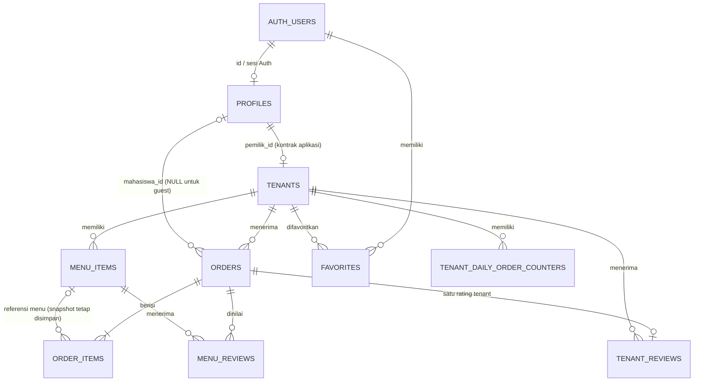

# Database SiKantin

## Catatan sumber skema

Migration aktif berada di `supabase/migrations/`. Migration yang tersedia menambahkan kolom/tabel/constraint/RLS untuk fitur-fitur di bawah, tetapi tidak menyertakan migration baseline yang pertama kali membuat `profiles`, `tenants`, `menu_items`, `orders`, dan `order_items`. `sikantin-astro/database/mysql-schema.sql` adalah skema MySQL lama, bukan DDL PostgreSQL aktif.

Karena itu, tabel dasar berikut mencatat kontrak kolom yang dipakai kode aktif dan migration yang tersedia. Kolom bertanda **kontrak aplikasi** perlu dibandingkan dengan `pg_catalog`/schema Supabase produksi sebelum dipakai sebagai DDL pemulihan; tipe dan FK dasar tidak boleh disimpulkan dari file MySQL lama. Kolom/constraint yang secara eksplisit dibuat oleh migration memiliki tipe dan aturan yang dinyatakan langsung.

## Tabel

### `profiles` — kontrak aplikasi + migration tambahan

| Kolom | Tipe referensi | Aturan / penggunaan |
|---|---|---|
| `id` | `uuid` | Identitas yang sama dengan pengguna Supabase Auth; dipakai sebagai owner/profile id. Definisi FK baseline tidak ada dalam migration repository. |
| `nama` | `text` | Nama yang ditampilkan. |
| `nim` | `text` | NIM mahasiswa; dicari untuk checkout/login. Unique pada data akun mahasiswa sesuai model aplikasi. |
| `peran` | `text` | Role aplikasi, antara lain `mahasiswa`, `pemilik_tenant`, `admin`. Trigger mencegah perubahan role oleh non-admin. |
| `no_telepon` | `text` | Ditambahkan oleh `20261029000004_student_dashboard.sql`; dipakai saat checkout/notifikasi. |
| `avatar_url` | `text` | Ditambahkan oleh migration mahasiswa; URL avatar. |
| `created_at`, `updated_at` | `timestamptz` | Timestamp dasar yang dipakai/dianggap oleh aplikasi; definisi baseline perlu diverifikasi. |

### `tenants` — kontrak aplikasi + migration

| Kolom | Tipe | Aturan / penggunaan |
|---|---|---|
| `id` | `uuid` | Primary key baseline; dirujuk tabel terkait. |
| `nama_tenant` | `text` | Nama tenant; slug diperbarui otomatis saat nama berubah. |
| `slug` | `text` | Ditambahkan oleh migration guest checkout; `NOT NULL`, unique index; dibangkitkan dari nama tenant. |
| `pemilik_id` | `uuid` | Menghubungkan tenant ke pemilik di `profiles`; RLS pemilik membatasi baris ke `auth.uid()`. |
| `lokasi` | `text` | Lokasi yang ditampilkan pada katalog. |
| `jam_operasional` | `text` | Representasi tampilan kompatibilitas, format `HH:MM - HH:MM`. |
| `jam_buka`, `jam_tutup` | `time` | Ditambahkan oleh `20261029000007_tenant_operating_hours.sql`. Keduanya harus sama-sama NULL atau terisi; tidak boleh sama. Rentang lintas tengah malam diperbolehkan. |
| `override_until` | `timestamptz` | Batas override manual berikutnya; setelah berakhir cron menghitung jadwal dan mengosongkannya. |
| `no_telepon` | `text` | Ditambahkan oleh migration admin. |
| `qris_image_url` | `text` | URL gambar QRIS publik. |
| `status_buka` | `boolean` | Status operasional efektif yang dibaca katalog dan Edge Function checkout. |
| `created_at`, `updated_at` | `timestamptz` | Timestamp dasar; verifikasi definisi awal di database. |

### `menu_items` — kontrak aplikasi + migration

| Kolom | Tipe referensi | Aturan / penggunaan |
|---|---|---|
| `id` | `uuid` | Primary key baseline. |
| `tenant_id` | `uuid` | Relasi menu ke tenant. |
| `nama_menu` | `text` | Nama produk. |
| `kategori` | `text` | Kategori filter menu. |
| `harga` | `numeric` | Harga; checkout mengambil nilai server/database. |
| `tersedia` | `boolean` | Hanya menu tersedia ditampilkan untuk pemesanan guest. |
| `foto_url` | `text` | Gambar menu. |
| `waktu_persiapan` | `integer NOT NULL DEFAULT 0` | Ditambahkan oleh migration admin. |
| `add_ons` | `jsonb NOT NULL DEFAULT '[]'` | Ditambahkan oleh `20261027000009_menu_addons.sql`; check `jsonb_typeof(add_ons) = 'array'`. |
| `created_at`, `updated_at` | `timestamptz` | Timestamp dasar, definisi baseline perlu diverifikasi. |

### `orders` — kontrak aplikasi + migration tambahan

| Kolom | Tipe referensi | Aturan / penggunaan |
|---|---|---|
| `id` | `uuid` | Primary key baseline. |
| `tenant_id` | `uuid` | Tenant yang menerima pesanan. |
| `mahasiswa_id` | `uuid NULL` | User Auth untuk order dari mahasiswa login; NULL pada guest. |
| `nim_guest` | `text NULL` | NIM pada order guest; ditambahkan oleh migration guest checkout. |
| `nama_mahasiswa`, `phone` | `text` | Snapshot identitas/kontak pada saat checkout. |
| `nomor_pesanan` | `text` | Identitas pesanan yang ditampilkan. |
| `token_pesanan` | `text NULL` | Token rahasia untuk pelacakan guest; unique index. |
| `nomor_antrean` | `text NULL` | Nomor antrean tenant harian, misalnya `A-01`. |
| `tanggal_antrean` | `date NULL` | Tanggal lokal antrean; unique index gabungan parsial dengan tenant dan nomor. |
| `status` | `text` | Status alur pesanan. |
| `total` | `numeric` | Total pesanan. |
| `metode_pembayaran` | `text NOT NULL DEFAULT 'qris'` | Check migration: hanya `qris` atau `tunai`. Bukti QRIS diperiksa manual. |
| `bukti_transfer` | `text NULL` | URL bukti transfer. |
| `alasan_pembatalan` | `text NULL` | Alasan penolakan/pembatalan. |
| `tenant_whatsapp` | `text NOT NULL DEFAULT 'not_applicable'` | Status integrasi WhatsApp tenant, ditambahkan migration notifikasi tenant. |
| `created_at`, `updated_at` | `timestamptz` | Timestamp order; `created_at` dipakai untuk sorting/riwayat. |

### `order_items` — kontrak aplikasi + migration

| Kolom | Tipe referensi | Aturan / penggunaan |
|---|---|---|
| `id` | `uuid` | Primary key baseline. |
| `order_id` | `uuid` | Relasi ke order. |
| `menu_item_id` | `uuid NULL` | Referensi item menu asal. |
| `nama_menu` | `text` | Snapshot nama menu saat transaksi. |
| `harga_satuan` | `numeric` | Harga snapshot per item; verifikasi tipe pada baseline aktif. |
| `jumlah` | `integer` | Kuantitas item. |
| `subtotal` | `numeric` | Subtotal item/add-on. |
| `catatan` | `text NULL` | Ditambahkan oleh migration catatan item. |
| `add_ons` | `jsonb NOT NULL DEFAULT '[]'` | Snapshot add-on; check harus berupa JSON array. |
| `created_at` | `timestamptz` | Timestamp baseline. |

### `favorites` — migration `20261029000004_student_dashboard.sql`

| Kolom | Tipe | Constraint |
|---|---|---|
| `id` | `uuid PRIMARY KEY DEFAULT gen_random_uuid()` | Identitas favorite. |
| `user_id` | `uuid NOT NULL REFERENCES auth.users(id) ON DELETE CASCADE` | Pemilik favorite. |
| `tenant_id` | `uuid NOT NULL REFERENCES public.tenants(id) ON DELETE CASCADE` | Tenant favorit. |
| `created_at` | `timestamptz NOT NULL DEFAULT now()` | Waktu dibuat. |
| Pasangan user/tenant | — | `UNIQUE (user_id, tenant_id)`. |

Index: `(user_id, created_at DESC)`.

### `menu_reviews` — migration `20261029000000_menu_reviews.sql`

| Kolom | Tipe | Constraint |
|---|---|---|
| `id` | `uuid PRIMARY KEY DEFAULT gen_random_uuid()` | — |
| `order_id` | `uuid NOT NULL REFERENCES orders(id) ON DELETE CASCADE` | — |
| `menu_item_id` | `uuid NOT NULL REFERENCES menu_items(id) ON DELETE CASCADE` | — |
| `rating` | `integer NOT NULL CHECK (rating BETWEEN 1 AND 5)` | Bintang 1–5. |
| `created_at` | `timestamptz NOT NULL DEFAULT now()` | — |
| `(order_id, menu_item_id)` | — | `UNIQUE`; satu rating menu per item pesanan. |

Index: `menu_item_id`. Data rating menu lama dimigrasikan menjadi rating tenant.

### `tenant_reviews` — migration `20261029000001_tenant_reviews.sql`

| Kolom | Tipe | Constraint |
|---|---|---|
| `order_id` | `uuid PRIMARY KEY REFERENCES orders(id) ON DELETE CASCADE` | Satu review per pesanan. |
| `tenant_id` | `uuid NOT NULL REFERENCES tenants(id) ON DELETE CASCADE` | Tenant yang dinilai. |
| `rating` | `integer NOT NULL CHECK (rating BETWEEN 1 AND 5)` | Bintang 1–5. |
| `created_at` | `timestamptz NOT NULL DEFAULT now()` | — |

Index: `tenant_id`.

### `tenant_daily_order_counters` — migration `20261028000000_daily_order_queue.sql`

| Kolom | Tipe | Constraint |
|---|---|---|
| `tenant_id` | `uuid NOT NULL REFERENCES tenants(id) ON DELETE CASCADE` | — |
| `order_date` | `date NOT NULL` | Tanggal `Asia/Jakarta`. |
| `last_number` | `integer NOT NULL CHECK (last_number > 0)` | Counter bertambah per tenant/tanggal. |
| `(tenant_id, order_date)` | — | Primary key gabungan. |

### `messages` — migration `20261027000008_whatsapp_messages.sql`

| Kolom | Tipe | Constraint |
|---|---|---|
| `id` | `bigint GENERATED BY DEFAULT AS IDENTITY PRIMARY KEY` | — |
| `wa_message_id` | `text NOT NULL UNIQUE` | ID pesan WhatsApp. |
| `sender_jid` | `text NOT NULL` | JID pengirim. |
| `push_name` | `text NULL` | Nama profil pengirim. |
| `message_type` | `text NOT NULL` | Jenis pesan. |
| `message_text` | `text NULL` | Isi teks bila tersedia. |
| `message_timestamp` | `timestamptz NOT NULL` | Waktu pesan. |
| `created_at` | `timestamptz NOT NULL DEFAULT now()` | Waktu tersimpan di database. |

Index: `message_timestamp DESC`.

## Relasi

Relasi dasar antar core tables di atas mengikuti query relasional aplikasi dan skema legacy; migration PostgreSQL yang tersedia secara eksplisit menyatakan FK untuk `favorites`, review, dan counter. Cocokkan seluruh constraint baseline di database aktif sebelum melakukan restore.

## Row Level Security

| Tabel | Akses RLS yang diterapkan |
|---|---|
| `profiles` | Semua user authenticated dapat membaca sesuai policy yang ada; user dapat mengubah baris sendiri; admin dapat mengubah/menghapus. Trigger mencegah non-admin mengubah `peran`. Admin dapat membuat/mengubah akun lewat jalur admin. |
| `tenants` | `anon` dan authenticated dapat membaca tenant. Pemilik dapat mengubah tenant miliknya; admin dapat insert/update/delete. RPC status manual memvalidasi `auth.uid()` sebagai `pemilik_id`. |
| `menu_items` | Authenticated dapat membaca; guest hanya membaca menu `tersedia` yang terhubung tenant. Pemilik tenant dapat CRUD menu sendiri; admin CRUD semua menu. |
| `orders` | Authenticated dapat membaca order sendiri, order tenant miliknya, atau semua order sebagai admin. Insert langsung hanya untuk mahasiswa login dengan `mahasiswa_id = auth.uid()`. Update authenticated dibatasi ke status dan alasan pembatalan, dengan policy pemilik tenant. Guest order dibuat Edge Function melalui service role. |
| `order_items` | Read jika parent order dapat diakses; insert oleh mahasiswa login untuk order miliknya. Guest order ditulis Edge Function/service role. |
| `favorites` | Select/insert/delete hanya untuk user yang sama dan role mahasiswa. |
| `menu_reviews` | RLS aktif dan table privileges dicabut dari `anon`/authenticated. Kirim rating, agregasi, dan pembacaan publik dilakukan lewat RPC `SECURITY DEFINER` dengan validasi token/status. |
| `tenant_reviews` | RLS aktif dan table privileges dicabut dari `anon`/authenticated. Operasi dilakukan melalui RPC rating dan agregasi `SECURITY DEFINER`. |
| `tenant_daily_order_counters` | RLS aktif dan akses table dicabut dari `PUBLIC`, `anon`, dan `authenticated`; nomor dialokasikan melalui RPC khusus service role. |
| `messages` | RLS aktif; table tidak diberikan ke `PUBLIC`, `anon`, atau `authenticated`; `service_role` mendapat select/insert/update. |

### Storage policies

- `qris-images` dan `menu-images`: pembacaan publik; insert/update/delete oleh admin authenticated.
- `avatars`: pembacaan publik; user authenticated dapat insert/update/delete dalam folder dengan nama `auth.uid()`.
- `bukti-transfer`: migration mengaktifkan pembacaan publik. Upload dilakukan Edge Function dengan service role.

> RLS/privilege di atas merangkum migration dalam repository, bukan audit konfigurasi proyek Supabase live. Policies tambahan yang dibuat langsung pada dashboard Supabase perlu diperiksa sebelum rilis.

## Functions / triggers penting

| Nama | Kegunaan |
|---|---|
| `set_tenant_slug` trigger | Membuat slug unik dari nama tenant. |
| `prevent_profile_role_escalation` trigger | Mencegah perubahan ID/role profil yang tidak berwenang. |
| `broadcast_guest_order_status` trigger | Mengirim payload Realtime saat status order guest berubah. |
| `next_tenant_queue_number(uuid)` | Mengalokasikan nomor antrean per tenant dan tanggal WIB; execute dibatasi ke `service_role`. |
| `lookup_guest_order_with_queue(text)` | Mencari ringkasan order dan item menggunakan token. |
| `submit_guest_order_rating(text, integer)` | Validasi token/status selesai dan menyimpan rating tenant 1–5. |
| `get_public_tenant_ratings(uuid)` | Menghasilkan agregat rating tenant. |
| `refresh_tenant_open_status()` | Fungsi scheduler; mempertahankan override aktif, selain itu menghitung status sesuai jadwal WIB. |
| `set_tenant_manual_status(uuid, boolean)` | Memastikan pemanggil pemilik tenant, memperbarui status, dan menghitung `override_until` berikutnya. |

## Migrasi operasional jadwal

`20261029000007_tenant_operating_hours.sql` menambah `jam_buka`, `jam_tutup`, `override_until`, constraint pasangan jam, dua fungsi jadwal, dan cron `refresh-tenant-open-status` per menit. Format lama `jam_operasional` `HH:MM-HH:MM`, `HH.MM–HH.MM`, dan dash sejenis di-backfill jika valid. Nilai bebas yang tidak cocok tetap perlu diatur ulang oleh admin.
