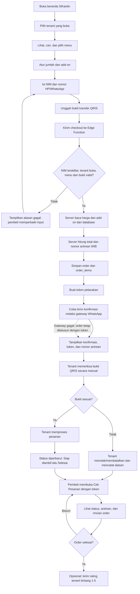
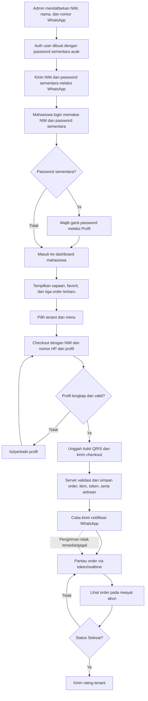
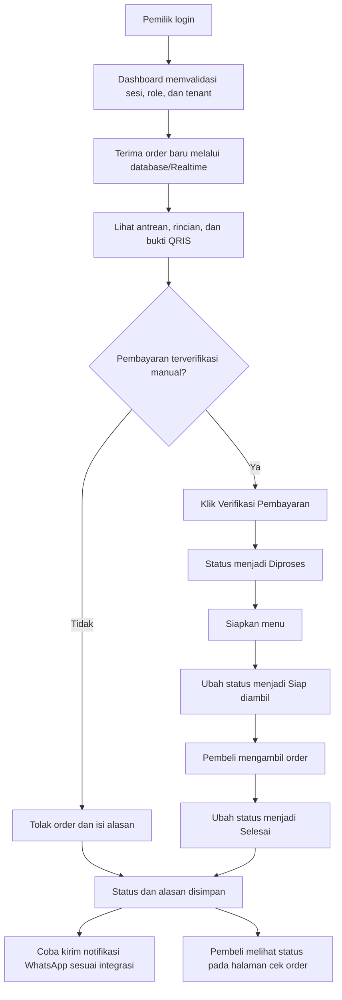
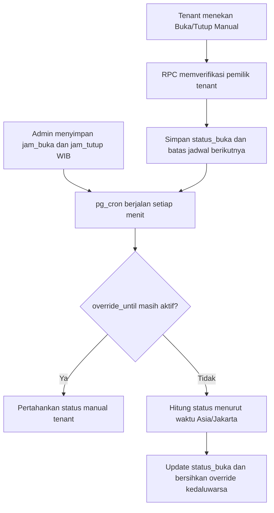
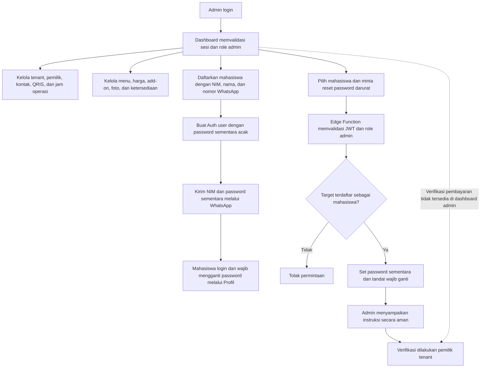
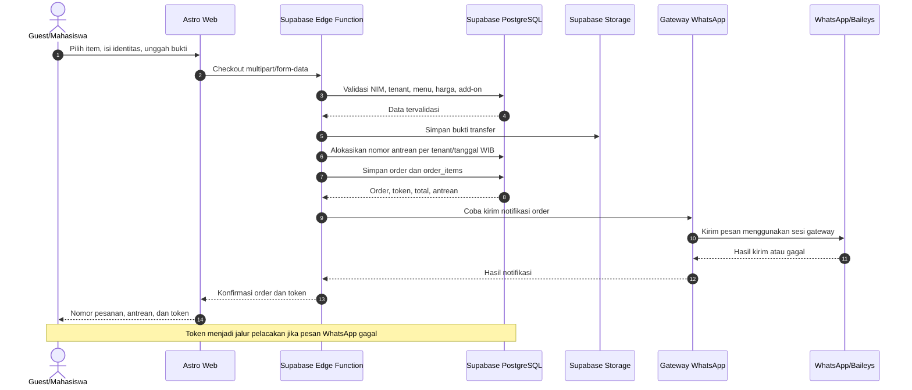
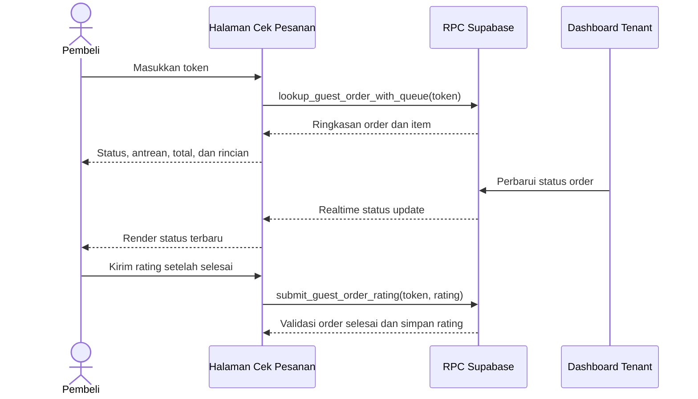

# Flowchart SiKantin

Diagram berikut membedakan alur yang tersedia saat ini dari kondisi eksternal yang harus disiapkan (Supabase dan gateway WhatsApp). QRIS adalah proses manual. Verifikasi pembayaran saat ini dilakukan tenant; aksi verifikasi admin belum tersedia di dashboard.

## 1. Guest Flow

## 2. Mahasiswa Login Flow

> Email `[NIM]@uym.ac.id` hanya dipakai sebagai identitas internal Supabase Auth. Password sementara dikirim melalui WhatsApp, bukan email.

## 3. Tenant Flow

### Buka/tutup tenant

## 4. Admin Flow

## 5. Sequence Checkout dan WhatsApp

## 6. Cek Status dan Rating

