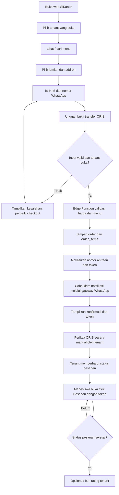
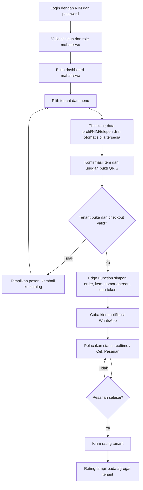
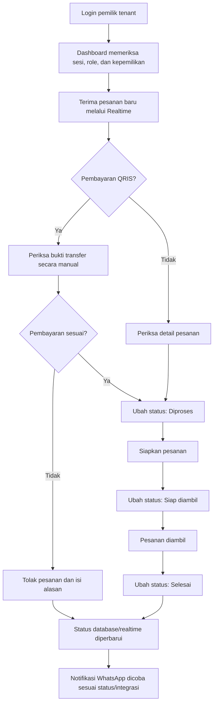
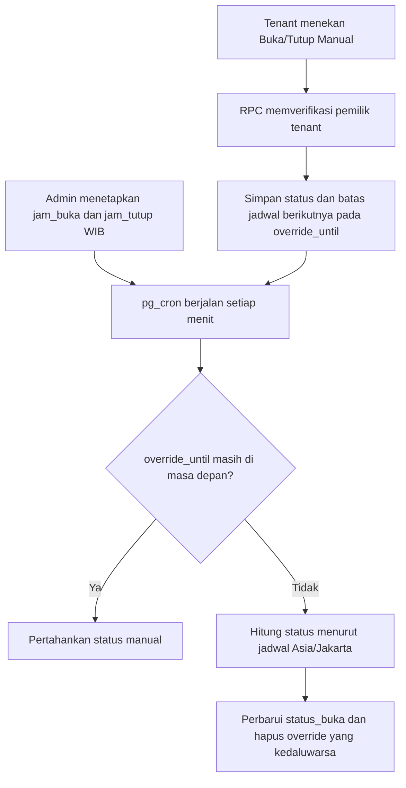
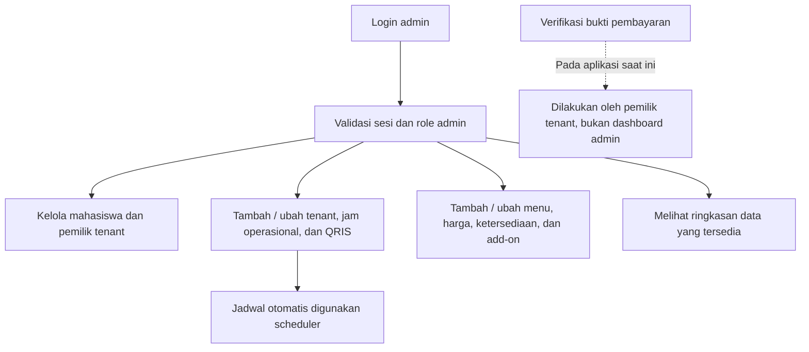

# Flowchart SiKantin

Diagram menggambarkan alur yang tersedia pada aplikasi saat ini. Cabang QRIS tetap manual; notifikasi WhatsApp tidak menjadi syarat keberhasilan penyimpanan pesanan.

## Mahasiswa (Guest)



## Mahasiswa (Login)



## Tenant



### Status operasional tenant



## Admin



## Batas Integrasi WhatsApp

```mermaid
sequenceDiagram
    participant Web as Browser
    participant EF as Supabase Edge Function
    participant DB as PostgreSQL
    participant GW as Gateway Node.js
    participant WA as WhatsApp via Baileys

    Web->>EF: Checkout dengan data pesanan dan bukti QRIS
    EF->>DB: Validasi dan simpan order serta detail
    DB-->>EF: Order tersimpan + token + antrean
    EF->>GW: Coba kirim pesan melalui HTTPS
    GW->>WA: Kirim menggunakan sesi gateway
    WA-->>GW: Hasil pengiriman
    GW-->>EF: Hasil berhasil/gagal
    EF-->>Web: Konfirmasi order; status notifikasi terpisah
```
