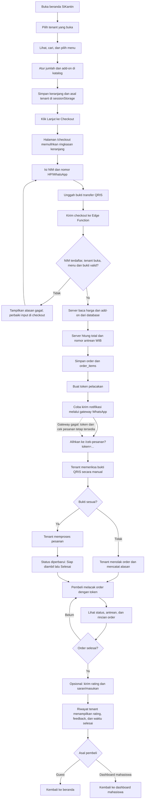
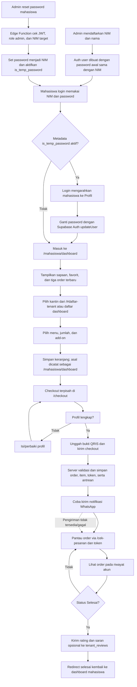
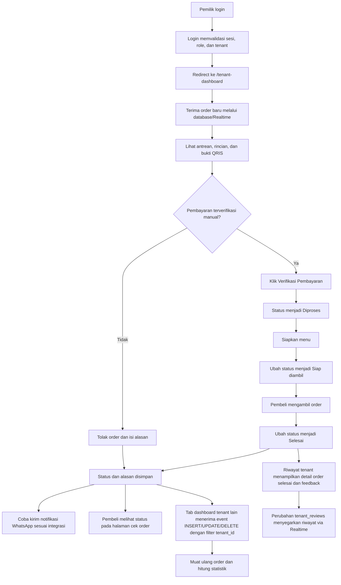
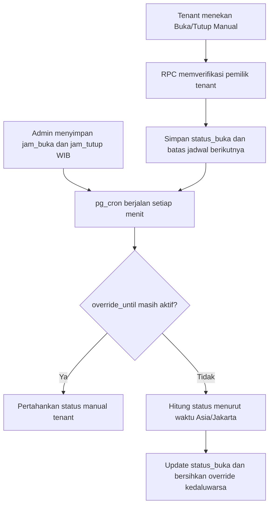
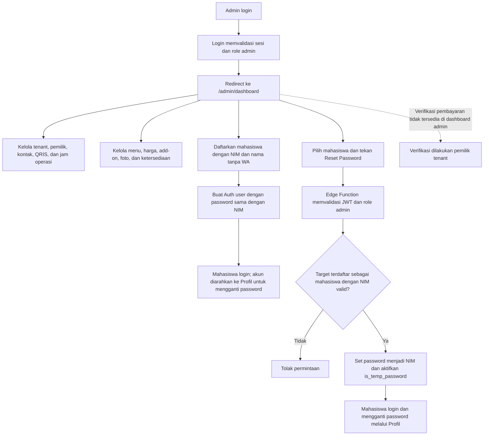
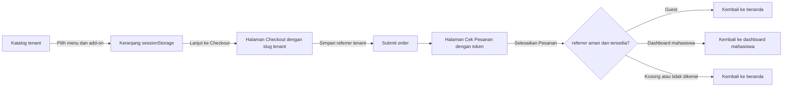
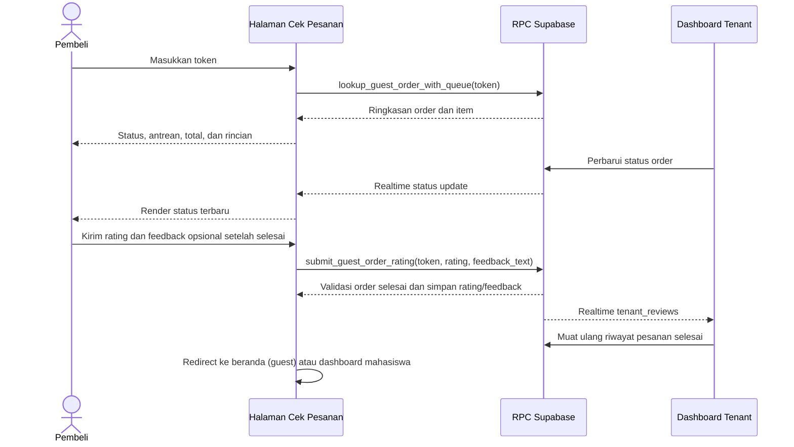

# Flowchart SiKantin

Diagram berikut membedakan alur yang tersedia saat ini dari kondisi eksternal yang harus disiapkan (Supabase dan gateway WhatsApp). QRIS adalah proses manual. Verifikasi pembayaran saat ini dilakukan tenant; aksi verifikasi admin belum tersedia di dashboard.

## 1. Guest Flow



## 2. Mahasiswa Login Flow



> Email `[NIM]@uym.ac.id` hanya dipakai sebagai identitas internal Supabase Auth. Registrasi tidak mengirim email atau WhatsApp.

## 3. Tenant Flow



Ringkasan pendapatan dan jumlah order pada dashboard tenant dapat difilter berdasarkan Hari Ini, 7 Hari Terakhir, atau Bulan Ini menggunakan tanggal `created_at` WIB. Pendapatan mengecualikan pesanan dibatalkan.

### Buka/tutup tenant



## 4. Admin Flow



## 5. Checkout Terpisah dan Navigasi Sesi



## 6. Sequence Checkout dan WhatsApp

```mermaid
sequenceDiagram
    autonumber
    actor Buyer as Guest/Mahasiswa
    participant Web as Astro Web
    participant EF as Supabase Edge Function
    participant DB as Supabase PostgreSQL
    participant Storage as Supabase Storage
    participant Gateway as Gateway WhatsApp
    participant WA as WhatsApp/Baileys

    Buyer->>Web: Pilih item, jumlah, dan add-on di katalog tenant
    Web->>Web: Simpan cart dan tenant sebagai asal di sessionStorage
    Buyer->>Web: Lanjut ke halaman /checkout
    Web-->>Buyer: Tampilkan ringkasan cart; identitas dan pembayaran
    Buyer->>Web: Isi identitas dan unggah bukti QRIS
    Web->>EF: Checkout multipart/form-data
    EF->>DB: Validasi NIM, tenant, menu, harga, add-on
    DB-->>EF: Data tervalidasi
    EF->>Storage: Simpan bukti transfer
    EF->>DB: Alokasikan nomor antrean per tenant/tanggal WIB
    EF->>DB: Simpan order dan order_items
    DB-->>EF: Order, token, total, antrean
    EF->>Gateway: Coba kirim notifikasi order
    Gateway->>WA: Kirim pesan menggunakan sesi gateway
    WA-->>Gateway: Hasil kirim atau gagal
    Gateway-->>EF: Hasil notifikasi
    EF-->>Web: Konfirmasi order dan token
    Web->>Web: Simpan asal untuk redirect dan bersihkan cart
    Web-->>Buyer: Redirect ke /cek-pesanan?token=...
    Note over Buyer,DB: Token menjadi jalur pelacakan jika pesan WhatsApp gagal
```

Saat tenant menolak order, `notify-order-rejected` mencoba mengirim alasan penolakan ke `orders.phone`. Formatnya: `Mohon maaf, pesanan Anda [Nomor Pesanan] di [Nama Tenant] ditolak. Alasan: [Alasan]. Silakan pesan menu lain.` Pengiriman ini tidak mengubah status transaksi database atau mengubah gateway/Baileys.

## 7. Cek Status dan Rating


