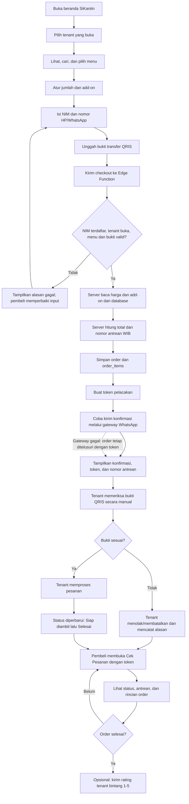
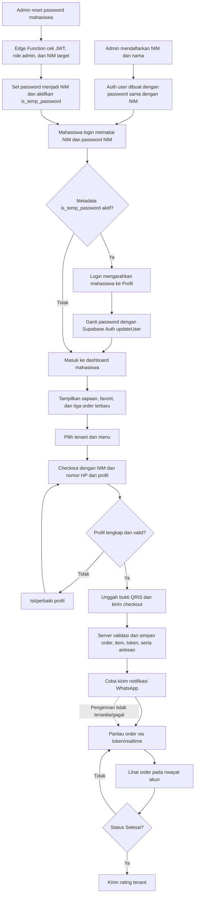
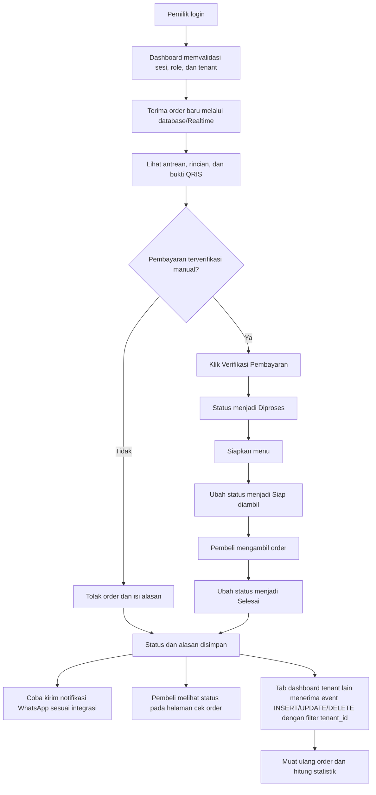
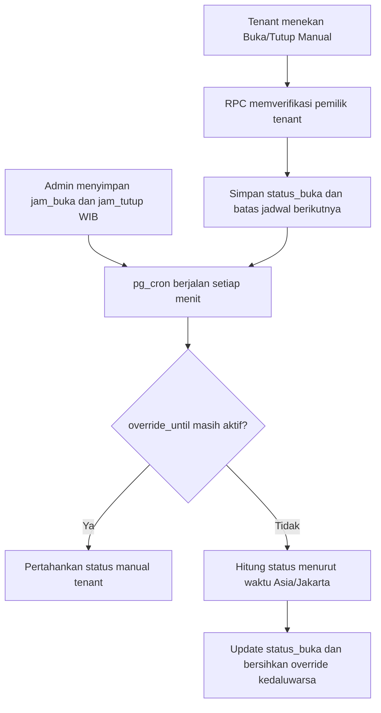
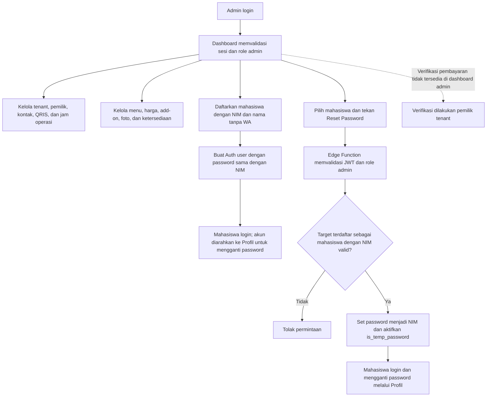
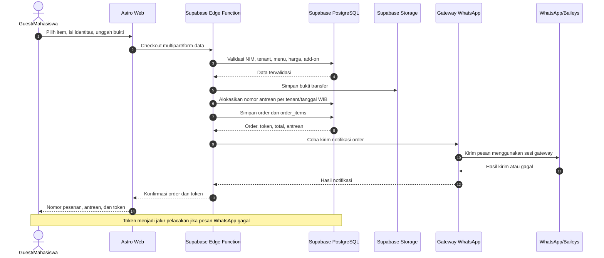
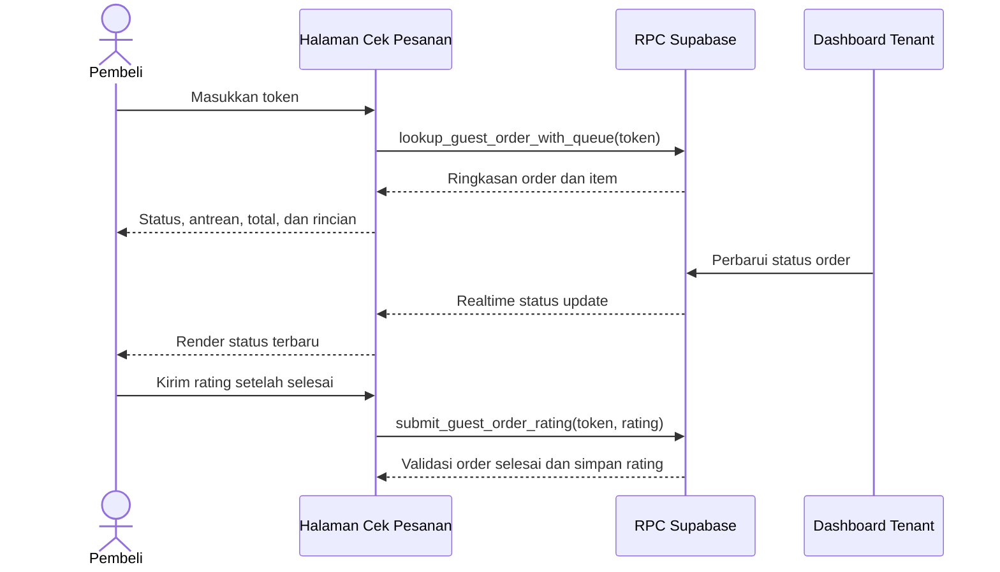

# Flowchart SiKantin

Diagram berikut membedakan alur yang tersedia saat ini dari kondisi eksternal yang harus disiapkan (Supabase dan gateway WhatsApp). QRIS adalah proses manual. Verifikasi pembayaran saat ini dilakukan tenant; aksi verifikasi admin belum tersedia di dashboard.

## 1. Guest Flow

## 2. Mahasiswa Login Flow

> Email `[NIM]@uym.ac.id` hanya dipakai sebagai identitas internal Supabase Auth. Registrasi tidak mengirim email atau WhatsApp.

## 3. Tenant Flow

### Buka/tutup tenant

## 4. Admin Flow

## 5. Sequence Checkout dan WhatsApp

Saat tenant menolak order, `notify-order-rejected` mencoba mengirim alasan penolakan ke `orders.phone`. Formatnya: `Mohon maaf, pesanan Anda [Nomor Pesanan] di [Nama Tenant] ditolak. Alasan: [Alasan]. Silakan pesan menu lain.` Pengiriman ini tidak mengubah status transaksi database atau mengubah gateway/Baileys.

## 6. Cek Status dan Rating

